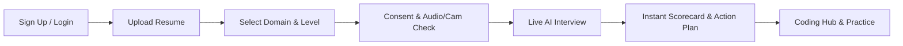

# PrepHire.AI — AI-Powered Mock Interview & Placement Platform

<div align="center">

[](https://prephire-ai.web.app)
[](https://react.dev/)
[](https://www.typescriptlang.org/)
[](https://vitejs.dev/)
[](https://firebase.google.com/)

**Master campus recruitment with resume-tailored AI voice interviews, real-time proctored evaluations, and an interactive coding arena.**

*Designed for Placement Cells, Faculty Mentors, and Engineering Students*

</div>

---

## 🌟 What is PrepHire.AI?

**PrepHire.AI** is an all-in-one placement preparation and assessment platform designed to help students build confidence and excel in campus placement drives. 

By combining conversational AI, resume intelligence, interactive code execution, and institutional oversight, PrepHire.AI delivers a realistic interview simulator that identifies strengths, pinpoints knowledge gaps, and provides concrete, actionable guidance.

---

## 🆕 What's New in the Latest Release

- 🧑‍🏫 **Department Question Studio & AI Problem Generation for Faculty**: Unlocked institutional challenge authoring and AI problem generation for Faculty mentors. Introduced a sleek dual-mode segmented control in `FacultyDashboard` (`✨ Question Studio & AI Generator` vs `💻 Student Practice Mode`), empowering department professors to author custom coding problems or prompt NVIDIA NIM (`qwen/qwen2.5-coder-32b-instruct` / `nvidia/llama-3.1-nemotron-70b-instruct`) with automated Piston sandbox pre-validation.
- 🎯 **CodeTantra-Style Faculty Coding Problem Assignment & Department Branch Targeting**: Integrated end-to-end faculty assignment workflows modeled after CodeTantra's digital learning and assessment lifecycle. Faculty and admins can target coding challenges to specific MIT AoE engineering branches or keep them open across campus, complete with optional submission due dates (`targetBranch`, `dueDate`, `assignedBy`).
- 📌 **Student Assigned Problem Hub with Dynamic Badging & Branch Filter**: Students are automatically presented with branch-specific assignment indicators (`🎯 Faculty Assigned`) and due dates across the coding challenge catalog and Monaco workspace. Features a dedicated filter toggle (`All Problems`, `🎯 Faculty Assigned (count)`, and `Open Practice`) allowing candidates to prioritize department lab tasks before free practice.
- 📱 **Fluid Responsive Layout Architecture**: Modernized Student, Faculty, and Admin portals with `.portal-layout` and `.portal-sidebar`, replacing rigid desktop grids with mobile-responsive horizontal navigators on tablet/mobile screens ($\le 860\text{px}$). Refactored Monaco coding workspace (`.workspace-grid`), KPI metric boards (`.coding-stats-grid`), and public landing page grids to adapt across mobile, tablet, and widescreen viewports.
- ♿ **WCAG AA Modal Dialog & Form Accessibility**: Standardized keyboard `Escape` dismissal, backdrop click closures, and `role="dialog"` attributes across the Resume ATS Scanner, Student Feedback modal, End Interview confirmation, and Cookie Preferences panel. Added programmatically associated `<label>` attributes and real-time screen-reader error announcements (`role="alert"` / `aria-live="polite"`) to authentication flows.
- 🎨 **Vector Icon Normalization & Theme Token Harmonization**: Replaced system emojis in notifications with Lucide React vector icons (`CheckCircle2`, `AlertCircle`, `Info`) for consistent cross-platform rendering. Added centralized semantic theme tokens (`T.info`, `T.infoBg`, `T.infoBorder`, `T.errorBg`, `T.errorBorder`) across all user portals.

- 🤖 **Automated Coding Problem Generator with NVIDIA NIM & Sandbox Pre-Validation**: Empowered faculty and administrators to generate complete, competition-grade programming problems in seconds using NVIDIA NIM (`qwen/qwen2.5-coder-32b-instruct` / `nvidia/llama-3.1-nemotron-70b-instruct`) and Google Gemini. By simply providing a brief topic prompt, the AI generates titles, Markdown statements, input/output formats, constraints, multi-language starter templates (Python, JavaScript, C++, Java), sample tests, and diverse hidden edge cases.
- 🛡️ **Multi-Tier AI Key Resolution & Autonomous Algorithmic Fallback**: Re-engineered problem generation backend resilience with a 3-tier key resolution cascade (`GEMINI_API_KEY` / `NVIDIA_API_KEY` / `VITE_GEMINI_API_KEY` server environment -> `x-gemini-key` client header forwarded securely from browser settings -> built-in algorithmic template generator). If external cloud AI keys are unconfigured or encounter rate limits on cloud hosting, the system seamlessly transitions to verified offline algorithmic templates (Selection Sort, Binary Search, Two Sum, etc.) complete with starter stubs across 5 languages, verified Python 3 reference solutions, and test cases pre-tested against Piston sandbox runtimes.
- 🧪 **Automated Piston Sandbox Pre-Validation & Resilient JSON Pipeline**: Fixed preflight execution telemetry mapping (`outcome.testResults` & `outcome.passedCount`) ensuring 100% accurate sandbox verification metrics (`Passed X of Y test cases`) in the authoring UI. Fortified LLM response parsing with regex fence extraction and substring boundary detection, guaranteeing resilient generation across NVIDIA NIM and Gemini even when conversational prefaces or formatting variations occur.
- ⚡ **Low-Latency Streaming AI & Sentence-Boundary Voice Pipeline**: Implemented Server-Sent Events (SSE) streaming (`POST /api/ai/stream`) coupled with an event-driven `SentenceBoundarySpeaker` (`streamingVoice.ts`) that vocalizes interview questions on the very first completed clause, slashing initial speech response latency from ~3500ms down to ~200ms.
- 📦 **Vite Modular Bundle Splitting & Code Chunking**: Configured high-performance Rollup vendor code-splitting (`vendor-react`, `vendor-firebase`, `vendor-monaco`, `vendor-tensorflow`, `vendor-icons`), slashing the initial JavaScript footprint by over 50% (1,524 kB → 741 kB) for instant initial page loads and sub-600ms build execution.
- 🏢 **Company-Specific Placement Tracks**: Added tailored mock interview tracks for marquee campus recruiters (TCS NQT, Infosys DSE, Amazon SDE, and Barclays FinTech), injecting real-world company evaluation rubrics, behavioral anchors (Amazon Leadership Principles), and specialized question graphs into the AI interview engine.
- 📄 **Instant Client-Side Resume ATS Matcher & JD Gap Matrix**: Integrated an instant (<20ms) local ATS analyzer (`atsAnalyzer.ts` & `AtsScannerModal.tsx`) evaluating candidate resumes against target job descriptions, outputting match scores (0-100%), missing keywords, quantitative metric audits, and actionable pre-interview suggestions.
- 🛡️ **Autonomous Offline Hybrid Question Library & Resilience Engine**: Eliminates single-point-of-failure dependency on external LLM APIs. If Gemini times out, errors, or hits rate limits (`429`), the platform seamlessly transitions to a pre-seeded multi-branch question graph with zero UI disruption or session halts.
- 🏛️ **Branch-Specialized Engineering Question Graphs**: Curated technical questions, key concept anchors, and adaptive follow-up probes across all 9 MIT AoE engineering programs (Computer, IT, AI&ML, Data Science, Software Eng, ENTC, Mechanical, Chemical, Civil), HR STAR behavioral sets, and aptitude tests.
- 📐 **Deterministic Heuristic Rubric Scoring Engine**: Offline evaluation engine that deterministically computes 5-dimensional radar scores (0-100) using keyword density matching, STAR framework structure parsing, speech delivery telemetry, and personalized 3-step weekly action plans even during complete internet or API outages.
- ⚡ **Real-Time Engine Status Indicator**: Subtle status pill (`⚡ Cloud AI` vs `🛡️ Autonomous Safe Mode`) in the live interview session header keeping candidates reassured and informed.
- 🌊 **Real-Time Live Audio Waveform Visualizer**: Integrated HTML5 Web Audio API canvas visualizer that delivers real-time waveform feedback while candidates speak and AI responds during proctored mock interviews.
- 🗣️ **Delivery & Speech Cadence Analytics**: In-depth speech pacing diagnostics tracking candidate Words Per Minute (WPM), delivery speed ratings, and verbal crutch/filler word count (`um`, `uh`, `like`, `basically`, `actually`).
- 📄 **Print & PDF Evaluation Reports**: Export clean, publication-grade A4 PDF evaluation summaries for candidates complete with dimensional radar charts, AI critique, speech metrics, and 3-step weekly action plans.
- 📊 **Faculty Batch Placement Gradebook Export**: One-click departmental CSV gradebook export enabling faculty and placement coordinators to analyze candidate readiness at scale.
- 💻 **Monaco Coding Custom Testcase Runner**: Custom standard input (`stdin`) console in the coding workspace allowing students to test arbitrary edge-case inputs against sandboxed runtimes.
- 🛡️ **Comprehensive Cookie Governance System**: Transparent GDPR/CCPA-compliant multi-category cookie registry (Strictly Necessary, Preferences, Analytics, Placement) with non-intrusive access points via the landing page footer and student profile settings.
- 🔒 **Security & Backend Persistence Hardening**: Token-verified authentication across drive upload and course endpoints, backed by resilient hybrid Firestore + JSON file storage.

---

## 🎯 Who is PrepHire.AI For?

| Role | How They Use the Platform |
|:---|:---|
| 🎓 **Students** | Practice tailored AI interviews, solve coding problems with AI feedback, track scores, study courses, and view leaderboard rankings. |
| 🧑‍🏫 **Faculty Mentors** | Review interview recordings and scorecards for students in their department, audit placement readiness, and share study courses. |
| 🛡️ **Placement Administrators** | Monitor campus-wide readiness metrics, manage user roles and branch assignments, create coding challenges, and review student feedback. |

---

## 🗺️ User Flows & How to Use

### 🎓 Student Flow



1. **Sign Up & Account Setup**:
   - Register using your name, email, password, and select your engineering department/branch.
2. **Resume Upload (Optional but Recommended)**:
   - Upload your PDF resume in the Interview tab. PrepHire extracts your projects, technical skills, and experience to personalize interview questions specifically for you.
3. **Select Interview Mode**:
   - Choose your interview focus:
     - **Technical**: Core DSA, System Design, Web Technologies, Database Systems, OOPs, and branch-specific subjects.
     - **HR & Behavioral**: STAR-method workplace situations, teamwork, leadership, and motivation.
     - **Aptitude**: Quantitative math, logical reasoning puzzles, and speed calculations.
     - **Group Discussion (GD)**: Structured arguments, counter-perspectives, and debate delivery.
   - Choose your difficulty: **Entry**, **Intermediate**, or **Advanced**.
4. **Consent & Verification**:
   - Review the pre-interview camera and audio notice and confirm consent to start your proctored session.
5. **Live AI Voice Interview**:
   - Speak naturally using your microphone or type your responses.
   - PrepHire asks one question at a time, providing calibrated micro-feedback and adjusting difficulty based on your answers.
6. **Instant Performance Scorecard & Action Plan**:
   - View your radar score across 5 key dimensions: **Technical Depth**, **Communication**, **Confidence**, **Clarity**, and **Relevance**.
   - Review specific strengths, targeted areas for improvement, and a **3-step concrete Action Plan** to work on this week.
7. **Coding Hub & AI Code Review**:
   - Practice algorithmic challenges directly in the browser with the built-in code editor.
   - Run tests against sample inputs and submit solutions.
   - Click **"Get AI Review"** after running code to receive instant analysis on correctness, time/space complexity, cleaner alternatives, and code readability.
8. **Courses, Leaderboard & Feedback**:
   - Browse curated courses and tutorials shared by faculty.
   - Track your position on the department leaderboard.
   - Tap the **Feedback** button anytime to share thoughts, report bugs, or request features.

---

### 🧑‍🏫 Faculty Flow

1. **Department Dashboard**:
   - Log in to your faculty portal. The dashboard is automatically scoped to candidates in your engineering branch.
2. **Review Student Interviews & Scorecards**:
   - Inspect individual student session records, radar breakdowns, AI feedback, and proctoring logs.
   - Assess placement readiness and provide personalized mentoring notes.
3. **Course Management**:
   - Create and organize department-specific learning resources, lecture notes, and practice materials for students.

---

### 🛡️ Admin Flow

1. **Overview & Analytics**:
   - Access real-time statistics on total registered students, completed interviews, average scores, and department distributions.
2. **User & Branch Management**:
   - View student and faculty rosters, reassign student branches when needed, and toggle account statuses.
3. **Coding Challenge Authoring**:
   - Create, edit, and publish coding problems with starter templates (Python, JavaScript, C++), visible test cases, and hidden judge test cases.
4. **Feedback Center**:
   - View feedback submitted by students during pilot testing, tagged by category (Bug, Suggestion, Confusing, Other).

---

## 🚀 Key Highlights

- 🎙️ **Natural Voice Interaction**: Real-time speech-to-text and synthetic voice prompts for realistic mock practice.
- 📄 **Smart Resume Analysis**: Personalizes questions based on each candidate's real-world projects and technical stack.
- 💻 **Integrated Code Editor**: Sandboxed multi-language programming workspace with immediate execution and AI code review.
- 📊 **Actionable Analytics**: Comprehensive radar charts, detailed rubrics, and concrete next steps rather than vague scores.
- 🏛️ **Institutional Scope**: Pre-configured support for 9 engineering branches with department-level isolation for faculty.
- 📱 **Mobile & Desktop Responsive**: Clean modern interface designed for smooth interaction across all screen sizes.

---

## 🏛️ Supported Engineering Programs

PrepHire.AI supports tailored tracks for 9 institutional branches:
- Computer Engineering
- Information Technology
- Computer Science & Engineering (AI & ML)
- Computer Science & Engineering (Data Science)
- Computer Engineering (Software Engineering)
- Electronics & Telecommunication Engineering
- Mechanical Engineering
- Chemical Engineering
- Civil Engineering

---

## ⚡ Quick Start & Local Setup

### Prerequisites
- **Node.js** (v20 or higher)
- **npm** (v10 or higher)

### 1. Clone & Install Dependencies

```bash
# Clone the repository
git clone https://github.com/pranav-4797/PrepHire-AI.git
cd PrepHire-AI

# Install client dependencies
npm install

# Install server dependencies
cd server
npm install
cd ..
```

### 2. Configure Environment Variables

Create `.env.local` in the root directory:
```env
VITE_FIREBASE_API_KEY=your_firebase_api_key
VITE_FIREBASE_AUTH_DOMAIN=your_project.firebaseapp.com
VITE_FIREBASE_PROJECT_ID=your_project_id
VITE_FIREBASE_STORAGE_BUCKET=your_project.firebasestorage.app
VITE_FIREBASE_MESSAGING_SENDER_ID=your_sender_id
VITE_FIREBASE_APP_ID=your_app_id
```

Create `server/.env` in the `server` directory:
```env
PORT=3001
GEMINI_API_KEY=your_gemini_api_key
PISTON_API_URL=https://emkc.org/api/v2/piston
```

### 3. Run Locally

```bash
npm run dev
```

- **Frontend**: [http://localhost:5173](http://localhost:5173)
- **Backend API**: [http://localhost:3001](http://localhost:3001)

---

## 🌐 Deployment Overview

PrepHire.AI is ready to deploy on modern cloud platforms:
- **Frontend Hosting**: Firebase Hosting (`firebase deploy --only hosting`)
- **Backend Service**: Render or Docker container (`render.yaml`)
- **Database**: Cloud Firestore (`firebase deploy --only firestore:rules`)

*For step-by-step administrator pilot deployment, refer to [`DEPLOY.md`](./DEPLOY.md).*

---

## 📄 License & Credits

Distributed under the **MIT License**. Built for **MIT Academy of Engineering (MIT AoE), Alandi (Pune)** — Placement & Career Development Cell.
