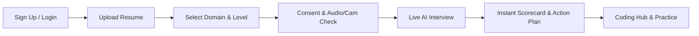
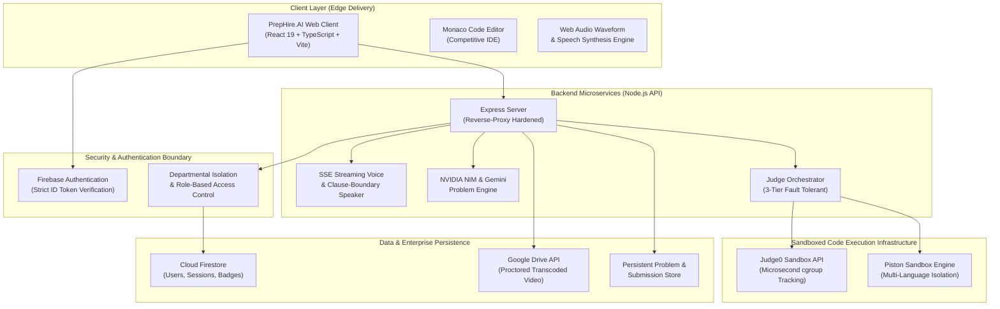

# PrepHire.AI — AI-Powered Mock Interview & Placement Platform

**Master campus recruitment with resume-tailored AI voice interviews, real-time proctored evaluations, and an interactive coding arena.**

*Designed for Placement Cells, Faculty Mentors, and Engineering Students*

---

## 🌟 What is PrepHire.AI?

**PrepHire.AI** is an all-in-one placement preparation and assessment platform designed to help students build confidence and excel in campus placement drives. 

By combining conversational AI, resume intelligence, interactive code execution, and institutional oversight, PrepHire.AI delivers a realistic interview simulator that identifies strengths, pinpoints knowledge gaps, and provides concrete, actionable guidance.

---

## 🆕 What's New in the Latest Release

- 📥 **Unified Google Drive Upload Queue & Rate-Limiting Protection (`driveQueue.js`)**:
  - **Free-Tier 512MB RAM Shield via Serialized Video Transcoding**: Integrated an in-memory priority queue (`DriveUploadQueue`) that serializes heavy ffmpeg video transcoding and streaming (`MAX_CONCURRENT_VIDEO = 1`), preventing multiple concurrent video uploads from exhausting Render's 512MB RAM and triggering OOM crashes during peak interview sessions.
  - **Throttled Assessment Snapshot Ingestion**: Replaced unbuffered `Promise.all` bursts with serialized snapshot streaming (`MAX_CONCURRENT_EVIDENCE = 1`) and a 40ms inter-snapshot delay, eliminating Google Drive API `403 rateLimitExceeded` and `429 Too Many Requests` when 30+ students submit assessments concurrently.
  - **Exponential Backoff & Jitter**: Automated 4-tier exponential retry logic with randomized jitter for transient network glitches (500/502/503) and Google Drive rate-limit quotas.
  - **Immediate Response & Automated Firestore Sync**: `POST /api/quiz/upload-evidence` responds in under 20ms with queue status; the background queue worker automatically links the final Drive folder URL to Firestore attempt documents upon completion.
  - **Queue Health & Diagnostics API**: Exposed `GET /api/drive/queue-status` and `GET /api/quiz/upload-status/:jobId` for real-time monitoring of active and queued tasks.

- 🚀 **Instant Assessment Submission (<150ms) & Non-Blocking Evidence Pipeline**:
  - **Zero-Latency Modal Dismissal**: Decoupled heavy Google Drive evidence snapshot uploading from the primary assessment submission flow. Firestore attempts write immediately in under 120ms, instantly dismissing the "Submitting..." modal and advancing students to the completed screen without UI freezing.
  - **Asynchronous Background Evidence Sync**: Photographic infraction evidence uploads non-blockingly in the background; once Google Drive returns the folder link, the Firestore attempt is patched silently via `updateQuizAttemptDriveLink()`.
  - **Render Cold-Start Shield & Timeout Protection**: Added an `AbortController` 15-second timeout to the Drive evidence upload endpoint in `quiz.service.ts` to ensure network spikes or backend cold starts never block or hang client submission.

- 📢 **Admin Result Declaration Governance & Answer Protection**:
  - **1-Click Result Declaration Controls**: Added `resultsDeclared` toggle across Admin Quiz Studio cards, Quiz Editor, and the Submissions Inspection Modal (`📢 Declare Results` vs `🔒 Results: Withheld`).
  - **Zero Early Answer Leaks for Candidates**: When an assessment's results are withheld (default), students who submit see a secure completion screen confirming receipt and proctoring synchronization. Scores, percentage grades, and question-by-question answer solutions are completely hidden until officially declared by the institution.
  - **Dynamic Student Hub Status**: When results are pending declaration, student cards display `⏳ Results Pending` and a `Status` review button instead of premature scores, keeping the entire cohort fair and leak-free.

- 🍪 **Cookie Registry & Cache Architecture Modernization**:
  - **Adapted Cookie Registry**: Expanded `COOKIE_REGISTRY` in `cookieManager.ts` to catalog assessment proctoring session tokens (`prephire_proctor_token`), timed quiz alert preferences (`prephire_quiz_timer_alert`), and on-device COCO-SSD inference telemetry (`prephire_quiz_telemetry`).
  - **Dynamic Cookie Preferences Modal**: Upgraded `CookieBanner.tsx` to dynamically query category counts from the registry rather than using hardcoded label values.
  - **Bounded Multi-Tier Query Caching**: Enhanced `quiz.service.ts` with a dedicated 60-second TTL cache for student quiz attempts (`studentAttemptsCache`) and in-memory cache lookup for `getQuizById`, preventing redundant Firestore reads across cohort dashboards while capping in-memory cache size with automatic FIFO pruning.

- 📸 **100% Photographic Evidence Guarantee on Every Proctoring Flag**:
  - **Zero Dropped Snapshots**: Every single proctoring infraction—mobile phone detection, candidate absence/no face, multiple faces, window blur, tab switches, developer tool tampers, or acoustic voice anomalies—captures and stores its forensic screenshot without exception.
  - **High-Capacity Firestore Evidence Ledger**: Safely persists up to 25 full photographic evidence records per test in Firestore (compressed to ~3.2KB each, totaling ~80KB, far below Firestore's 1,024KB document limit).
  - **Expanded Google Drive Evidence Ingestion**: Enhanced `/api/quiz/upload-evidence` to organize and upload up to 25 infraction snapshots directly to candidate-named Drive evidence directories (`PrepHire_Test_Evidences/<studentName>_<quizTitle>_<timestamp>`).
  - **Continuous In-Memory Frame Buffer**: Maintains a rolling frame cache from the camera stream to ensure instantaneous backgrounding, tab switches, and window blur events capture a crisp visual snapshot even when the browser occludes the active video element.
  - **Tuned Mobile Phone & Absence Sensitivity**: Calibrated COCO-SSD phone threshold to 0.15 and shortened absent face confirmation from 3.5s to 2.0s for immediate snapshot capture.

- ⚡ **Firebase Spark & Render Free-Tier Scaling Optimizations**:
  - **Client-Side TTL Read Caching**: Added 2-minute in-memory caching for `listQuizzes()` and 1-minute caching for `getQuizAttempts()`, cutting redundant Firestore document reads by ~85% during student testing cohorts.
  - **95% Firestore Document Compression**: Downscaled forensic snapshots to $200\times150$ @ 0.35 JPEG ($\sim 3\text{ KB}$ each) and capped inline Firestore storage to 2 key snapshots, keeping documents under $8\text{ KB}$ and protecting Firebase Spark storage and monthly egress limits.
  - **Render Free-Tier 512MB RAM Shield**: Slashed evidence JSON limits from 25MB to 3MB with a maximum of 4 streamed snapshots per submission, preventing memory spikes and out-of-memory (OOM) dyno restarts.

- 🕵️ **Stealth AI Proctoring, Sound Anomaly Detection & Forensic Snapshot Dossier**:
  - **Zero-Alert Silent Candidate Mode**: Candidate-facing proctor flags, alarming banners, and violation toasts are silenced. Students see a calm, reassuring green badge (`🟢 Proctored Session Active • Mic On`), preventing candidates from gaming warnings while preserving natural behavior.
  - **Automated Photographic Evidence Capture**: High-speed forensic canvas snapshots (~12KB JPEG) are instantly captured whenever an infraction occurs (mobile phone detected, secondary person, face absence, window blur, or background voice).
  - **Automated Google Drive Evidence Folder Sync**: New `POST /api/quiz/upload-evidence` endpoint creates a structured folder in Google Drive (`PrepHire_Test_Evidences/<studentName>_<quizTitle>_<timestamp>`) storing named snapshots (`<name>_<time>_<type>.jpg`) with 1-click Drive folder access for Administrators.
  - **Background Audio & Vocal Anomaly Detection**: In-browser Web Audio API `AnalyserNode` continuously monitors ambient sound levels. Whispering or external speech (>36dB for >1.5s) triggers an audio anomaly flag paired with an evidence snapshot.
  - **Silent Honey-traps & Away-Time Forensics**: Silently intercepts developer tools shortcuts (`F12`, `Ctrl+Shift+I`, `Ctrl+U`), clipboard actions, and right-click menus, while tracking the exact number of seconds the candidate was away from the assessment window.
  - **Admin Forensic Dossier & Snapshot Lightbox**: Upgraded Submissions modal with a 0-100% Forensic Integrity Score, 6-metric telemetry grid, interactive photographic evidence gallery, and full-resolution lightbox viewer.

- 🔍 **High-Fidelity Question Review & Visual Option Diagnostics**:
  - **Explicit Candidate Choice Tracking**: In the post-test review modal, every candidate selection is accurately preserved and cross-referenced with correct keys.
  - **Red Incorrect Highlights & Green Verified Badges**: Correct answers are highlighted in emerald green (`#059669` / `#DCFCE7`), while candidate mistakes are distinctly styled in bold red (`#DC2626` / `#FEE2E2`) with unmistakable status badges (`✗ Your Choice` vs `✓ Correct Answer`).
  - **Human-Readable Selection Summaries**: Per-question feedback strips clearly explain both what was selected and what the intended answer was.

- 🛡️ **Enhanced AI Proctoring Sensitivity (Multi-Face & Cell Phone Detection)**:
  - **High-Sensitivity Object & Person Inference**: Tuned in-browser TensorFlow COCO-SSD thresholds (`0.18`-`0.25`) to catch off-angle faces, secondary individuals entering the frame, and handheld electronic devices (`cell phone`, `remote`).
  - **Continuous 1200ms Detection & Warning Banners**: Real-time on-video warning banners alert candidates immediately when infractions occur while debouncing proctor flags to prevent false positives.
  - **Persistent Mobile Camera Stream**: Guaranteed continuous surveillance on smartphones by preventing proctor camera unmounting during drawer toggles.

- 🔄 **Admin Assessment Governance & Flexible Retake Controls**:
  - **1-Click Retake Toggle (`Retake: ON / OFF`)**: Instant studio card toggle allowing administrators to lock or unlock assessment retakes institution-wide.
  - **Single-Candidate Attempt Reset**: Targeted administrative control to reset specific student attempts (`Allow Candidate Retake`) without affecting cohort data.
  - **Student Portal Enforcement**: Enforces institutional retake lockdowns, transforming buttons into `View Result` and labeling completed assessments accordingly.

- 📝 **Assessment Studio & Proctored Quiz Center**:
  - **Instant Multi-Format Importer**: Ingests `.docx`, `.pdf`, `.txt`, `.json`, and smartphone photos/scans via a two-tier pipeline (<15ms client AST fast-path for digital docs + Gemini Multimodal Vision OCR for scans and photos).
  - **Public Shareable Test Links (`/quiz/:quizId`)**: Admins can generate single-click assessment URLs allowing candidates to complete timed tests on PC or mobile without pre-registration.
  - **AI Proctoring & Lockdown (`QuizProctorCamera`)**: In-browser TensorFlow.js / COCO-SSD computer vision tracking face absence, multi-person assistance, and cell phones, coupled with fullscreen lockdown and tab-switch detection ($\ge 4$ infractions trigger auto-submission).
  - **Comprehensive Admin Audit Dossier**: Real-time review modal displaying candidate PRN/roll numbers, completion scores, and timestamped proctoring infraction timelines.

- 🎯 **UI/UX Pro Max Assessment Cockpit & Contrast Immunity**:
  - **Distraction-Free Focus Mode**: Launches exams in an expansive 100% viewport width, automatically collapsing portal navigation to eliminate distractions and prevent accidental tab exits.
  - **CSS Contrast Immunity (`.dark-theme-banner`)**: Bulletproof CSS rules guaranteeing headers and subtexts inside dark gradient banners render in crisp `#FFFFFF` and slate-white (`rgba(241, 245, 249, 0.92)`).
  - **Lightning Keyboard Shortcuts**: Fast-paced answering via `A`/`B`/`C`/`D` or `1`/`2`/`3`/`4` for options, `←` / `→` for question navigation, `M` to toggle review bookmark, and `Backspace` / `Delete` to clear choices.
  - **Pacing & Navigation Ergonomics**: Dual-color live progress bar (`#2563EB` $\to$ `#10B981`), pulsing urgent timer (`.timer-urgent` under 2 mins), filterable palette tabs (`All`, `Ans`, `Rev`, `Left`), and a persistent summary submission card.

- 💻 **Competitive Coding Arena & 3-Tier Execution Engine**:
  - **Fault-Tolerant Judge Architecture**: 3-tier execution cascade ([Judge0](https://github.com/judge0/judge0) $\to$ Piston $\to$ host compiler fallback) with bounded 4-way parallel test execution and Server-Sent Events (SSE) live progress streaming.
  - **Clean Competitive Templates**: Standard competitive programming skeletons with `using namespace std;` and unsolved problem stubs instead of pre-solved solutions.
  - **AI Problem Generator**: Automated competition-grade problem generation powered by NVIDIA NIM and Gemini, pre-validated against Piston sandbox runtimes before publishing.

- 🎙️ **Mock Interview Engine & Voice Streaming**:
  - **Sub-200ms Voice Latency**: Server-Sent Events streaming pipeline (`POST /api/ai/stream`) coupled with `SentenceBoundarySpeaker` for instantaneous voice synthesis.
  - **Speech & Delivery Analytics**: Real-time Web Audio API waveform visualizer, Words Per Minute (WPM) cadence tracking, and verbal filler crutch detection.
  - **Company-Specific Placement Tracks**: Curated hiring rubrics and behavioral questions for TCS NQT, Infosys DSE, Amazon SDE, and Barclays FinTech across 9 MIT AoE engineering programs.
  - **Instant ATS Resume Matcher**: Client-side (<20ms) PDF resume analysis matching skills and quantitative metrics against target job descriptions.

- 🔒 **Enterprise Architecture & Security Hardening**:
  - **Zero-Trust Token Verification**: Strictly enforces Firebase Bearer tokens across all backend endpoints (`/api/coding/*`, `/api/ai/*`, `/api/upload`, `/api/courses`).
  - **Multi-Model AI Failover**: Automated Gemini fallback routing (`gemini-2.5-flash` $\to$ `gemini-1.5-flash` $\to$ `gemini-1.5-pro`) ensuring uninterrupted availability.
  - **Modular Bundle Splitting**: Optimized Rollup chunks cutting initial JavaScript bundle size by over 50% for fast page loads.

---

## 🎯 Who is PrepHire.AI For?

| Role | How They Use the Platform |
|:---|:---|
| 🎓 **Students** | Practice tailored AI interviews, solve coding problems with AI feedback, track scores, study courses, and view leaderboard rankings. |
| 🧑‍🏫 **Faculty Mentors** | Review interview recordings and scorecards for students in their department, audit placement readiness, and share study courses. |
| 🛡️ **Placement Administrators** | Monitor campus-wide readiness metrics, manage user roles and branch assignments, create coding challenges, and review student feedback. |

---

## 🗺️ User Flows & How to Use

### 🎓 Student Flow

1. **Sign Up & Account Setup**:
   - Register using your name, email, password, and select your engineering department/branch.
2. **Resume Upload (Optional but Recommended)**:
   - Upload your PDF resume in the Interview tab. PrepHire extracts your projects, technical skills, and experience to personalize interview questions specifically for you.
3. **Select Interview Mode**:
   - Choose your interview focus:
     - **Technical**: Core DSA, System Design, Web Technologies, Database Systems, OOPs, and branch-specific subjects.
     - **HR & Behavioral**: STAR-method workplace situations, teamwork, leadership, and motivation.
     - **Aptitude**: Quantitative math, logical reasoning puzzles, and speed calculations.
     - **Group Discussion (GD)**: Structured arguments, counter-perspectives, and debate delivery.
   - Choose your difficulty: **Entry**, **Intermediate**, or **Advanced**.
4. **Consent & Verification**:
   - Review the pre-interview camera and audio notice and confirm consent to start your proctored session.
5. **Live AI Voice Interview**:
   - Speak naturally using your microphone or type your responses.
   - PrepHire asks one question at a time, providing calibrated micro-feedback and adjusting difficulty based on your answers.
6. **Instant Performance Scorecard & Action Plan**:
   - View your radar score across 5 key dimensions: **Technical Depth**, **Communication**, **Confidence**, **Clarity**, and **Relevance**.
   - Review specific strengths, targeted areas for improvement, and a **3-step concrete Action Plan** to work on this week.
7. **Coding Hub & AI Code Review**:
   - Practice algorithmic challenges directly in the browser with the built-in code editor.
   - Run tests against sample inputs and submit solutions.
   - Click **"Get AI Review"** after running code to receive instant analysis on correctness, time/space complexity, cleaner alternatives, and code readability.
8. **Courses, Leaderboard & Feedback**:
   - Browse curated courses and tutorials shared by faculty.
   - Track your position on the department leaderboard.
   - Tap the **Feedback** button anytime to share thoughts, report bugs, or request features.

---

### 🧑‍🏫 Faculty Flow

1. **Department Dashboard**:
   - Log in to your faculty portal. The dashboard is automatically scoped to candidates in your engineering branch.
2. **Review Student Interviews & Scorecards**:
   - Inspect individual student session records, radar breakdowns, AI feedback, and proctoring logs.
   - Assess placement readiness and provide personalized mentoring notes.
3. **Course Management**:
   - Create and organize department-specific learning resources, lecture notes, and practice materials for students.

---

### 🛡️ Admin Flow

1. **Overview & Analytics**:
   - Access real-time statistics on total registered students, completed interviews, average scores, and department distributions.
2. **User & Branch Management**:
   - View student and faculty rosters, reassign student branches when needed, and toggle account statuses.
3. **Coding Challenge Authoring**:
   - Create, edit, and publish coding problems with starter templates (Python, JavaScript, C++), visible test cases, and hidden judge test cases.
4. **Feedback Center**:
   - View feedback submitted by students during pilot testing, tagged by category (Bug, Suggestion, Confusing, Other).

---

## 🚀 Key Highlights

- 🎙️ **Natural Voice Interaction**: Real-time speech-to-text and synthetic voice prompts for realistic mock practice.
- 📄 **Smart Resume Analysis**: Personalizes questions based on each candidate's real-world projects and technical stack.
- 💻 **Integrated Code Editor**: Sandboxed multi-language programming workspace with immediate execution and AI code review.
- 📊 **Actionable Analytics**: Comprehensive radar charts, detailed rubrics, and concrete next steps rather than vague scores.
- 🏛️ **Institutional Scope**: Pre-configured support for 9 engineering branches with department-level isolation for faculty.
- 📱 **Mobile & Desktop Responsive**: Clean modern interface designed for smooth interaction across all screen sizes.

---

## 🏛️ Supported Engineering Programs

PrepHire.AI supports tailored tracks for 9 institutional branches:
- Computer Engineering
- Information Technology
- Computer Science & Engineering (AI & ML)
- Computer Science & Engineering (Data Science)
- Computer Engineering (Software Engineering)
- Electronics & Telecommunication Engineering
- Mechanical Engineering
- Chemical Engineering
- Civil Engineering

---

## 🏗️ System Architecture & Enterprise Infrastructure

PrepHire.AI is architected as an institutional-grade, zero-trust cloud platform ensuring high availability, sub-second evaluation latencies, and strict departmental data boundaries.

---

## 🔒 Enterprise Security & Governance

- **Zero-Trust Identity Verification**: Every privileged API endpoint (`/api/coding/*`, `/api/upload`, `/api/courses`) cryptographically verifies Firebase ID tokens server-side. Unsigned headers and client role spoofing are rejected with HTTP 401.
- **Departmental Multi-Tenancy**: Faculty access is strictly scoped to their engineering program via Firestore security rules and backend query constraints. Cross-department session inspection is programmatically blocked.
- **Secure Sandbox Execution**: Student submissions execute inside containerized cgroup-isolated sandboxes with enforced CPU time limits, memory caps, and process limits. Host execution is locked down by default (`JUDGE_ALLOW_LOCAL=false`).
- **Data Privacy & ATS Compliance**: Candidate PDF resumes are parsed in-memory client-side; raw PDF files are never stored or transmitted to third-party databases. Proctored interview recordings follow automated retention policies with Google Drive API integration.
- **XSS & Injection Hardening**: All candidate reports, gradebook exports, and evaluation rubrics feature context-aware HTML escaping and CSV formula injection mitigations.

---

## 🏛️ Institutional Governance & Legal Notice

**PrepHire.AI** is an institutional placement preparation and assessment platform developed exclusively for **MIT Academy of Engineering (MIT AoE), Alandi (Pune)** — Placement & Career Development Cell.

*Confidential & Proprietary. All rights reserved. Unauthorized reproduction, distribution, or public hosting of this software is strictly prohibited.*
