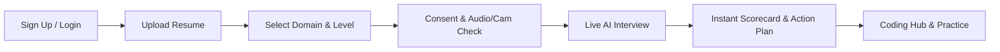
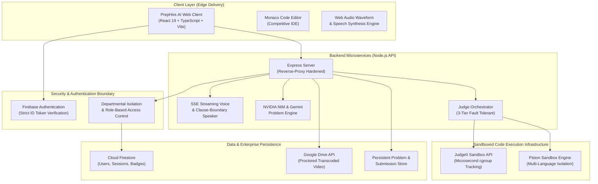

# PrepHire.AI — AI-Powered Mock Interview & Placement Platform

**Master campus recruitment with resume-tailored AI voice interviews, real-time proctored evaluations, and an interactive coding arena.**

*Designed for Placement Cells, Faculty Mentors, and Engineering Students*

---

## 🌟 What is PrepHire.AI?

**PrepHire.AI** is an all-in-one placement preparation and assessment platform designed to help students build confidence and excel in campus placement drives. 

By combining conversational AI, resume intelligence, interactive code execution, and institutional oversight, PrepHire.AI delivers a realistic interview simulator that identifies strengths, pinpoints knowledge gaps, and provides concrete, actionable guidance.

---

## 🆕 What's New in the Latest Release

- 🔗 **Shareable Public Assessment Links & AI Facial Scan Proctoring (`/quiz/:quizId`)**:
  - 🌐 **Dedicated Candidate Portal (`PublicQuizTake.tsx`)**: Admins can copy and share direct quiz links (`/quiz/:quizId`) with a single click. Any candidate can access the portal on mobile or desktop without pre-registration, input their details (Name, Email, Engineering Branch, Roll Number / PRN), test their camera stream, agree to academic integrity rules, and launch the proctored assessment.
  - 📱 **Cross-Platform Responsive Mobile & PC UI/UX**: Fluid layout supporting both mobile phones and desktop workstations. Includes collapsible question palette drawer, thumb-friendly 48px interactive option cards, sticky responsive timer cockpit, and pinned bottom navigation controls.
  - 🔒 **Fullscreen Lockdown & Tab-Switch Prevention**: Mandatory full-screen enforcement with automated modal lockdown upon exit. Monitors page visibility loss (`visibilitychange`) and window focus blur (`window.onblur`), recording timestamped infractions and auto-submitting the exam upon excessive violations ($\ge 4$). Disables clipboard copy/cut/paste and right-click context menu.
  - 👁️ **TensorFlow.js & COCO-SSD Facial Scan Proctor (`QuizProctorCamera.tsx`)**: Real-time in-browser computer vision surveillance detecting face absence from frame ($>4.5\text{s}$), multiple persons in camera view, and mobile phone usage. Automatically logs timestamped incident telemetry into Firestore submissions.
  - 🛡️ **Admin Submissions & Integrity Audit Dossier**: Enhanced Submissions modal in `AdminQuizManager.tsx` showing candidate PRN/roll numbers, public candidate badges, and an expandable Proctoring Integrity breakdown displaying tab switch counts, fullscreen exits, face alerts, and violation timelines.
  - 🔐 **Granular Firestore Security Rules**: Deployed updated `firestore.rules` allowing public candidates to submit proctored attempts to published assessments while protecting user and administrative data.

- 🎨 **Student Assessment Hub UI/UX Overhaul & Contrast Restoration**: Completely redesigned the header cockpit in `StudentQuizHub.tsx`:
  - 🌟 **High-Contrast Deep Navy Gradient**: Replaced dark inherited typography with crisp `#FFFFFF` headers, glowing amber badge (`ASSESSMENT CENTER`), and readable slate-white descriptions, eliminating color collisions with global CSS rules.
  - 📊 **Frosted Glass KPI Cockpit**: Integrated a translucent stats bar featuring glowing cyan (`Completed`) and emerald (`Avg Score`) metrics with real-time completion tracking.
  - 📚 **Modern Iconography & Card Polishing**: Replaced text badges with sleek Lucide icons (`BookOpen`, `Clock`, `Award`, `CheckCircle2`) and interactive action pills.

- ⚡ **Zero-Latency Two-Tier OCR & Assessment Importer**: Re-architected `quizDocParser.ts` for maximum throughput and minimum latency:
  - 🚀 **Tier 1: Instant Client-Side AST Fast-Path (< 15ms)**: Documents with digital text (`.docx`, digital `.pdf`, `.txt`, `.json`, `.csv`) are evaluated instantly in-memory using an optimized deterministic AST/regex parser. Correctly parses diverse answer patterns (e.g. `Correct Option: B. Mars`, `Ans: C`, `Answer: D`) and prevents question number prefixes (`1.`, `2.`) from being misclassified as options. If structured MCQs are detected, questions load in **sub-15 milliseconds** with zero network roundtrips or server lag.
  - 🎨 **Client-Side Canvas Pre-Scaling (98% Payload Reduction)**: High-resolution phone camera photos and scanned sheets (8MB–15MB) are dynamically downscaled via HTML5 canvas to optimal OCR thresholds ($\le 1600px$) and compressed to crisp JPEG (0.82 quality) before transmission, slashing upload payloads down to **~150KB** and cutting Vision AI evaluation time by up to 4x.
  - 👁️ **Tier 2: Multimodal Vision OCR**: Automatically engages for scanned photocopies, smartphone photos, and Word docs with embedded image clippings, reading printed text, code snippets, and answer keys.

- 👁️ **Multimodal Vision OCR for Scanned PDFs, Word Docs & Exam Photos**: Integrated optical character recognition (OCR) and multimodal vision into the Quiz Studio importer:
  - 📸 **Scanned PDF & Photocopy OCR**: Ingests image-only and photocopy PDFs without selectable text layers, sending native PDF document streams directly to Gemini Vision to transcribe printed text, math notation, and code into structured MCQs.
  - 🖼️ **Word Document Embedded Image OCR (`.docx`)**: Automatically extracts screenshots and photo clippings embedded inside Word files, routing both the text paragraphs and embedded images to the vision model.
  - 📱 **Camera Photos & Screenshots (`.png`, `.jpg`, `.jpeg`, `.webp`)**: Allows faculty and admins to upload smartphone photos or screenshots of question papers, automatically reading question statements, options A-D, and answer keys.
  - 🛡️ **25MB High-Capacity Multimodal Buffer**: Expanded Express JSON body parser to 25MB and reinforced authentication middleware with token-level rate limiting.

- 📄 **Multi-Format Quiz Document Importer (`.docx`, `.pdf`, `.txt`, `.json`)**: One-click assessment import allowing administrators and faculty to upload raw question papers or quiz documents directly into the Quiz Studio:
  - 📂 **Multi-Extension Support**: Ingests `.docx`, `.pdf`, `.png`, `.jpg`, `.txt`, `.json`, and `.csv` files without requiring manual question re-typing.
  - 🧠 **Dual-Engine Parser (`quizDocParser.ts`)**: Combines intelligent Gemini Multimodal AI structuring with deterministic regex heuristic fallbacks to reliably extract question statements, code snippets, 4 options (A, B, C, D), correct answer indicators (`Ans: B`, `Correct: C`), and technical explanations.
  - ⚡ **Direct Studio Population**: Available in both `AdminQuizManager` and `AdminQuizEditor`, instantly populating question inventories with visual confirmation.

- 📝 **Admin-Managed Assessment Studio & Timed Student Quizzes**: Integrated an institutional MCQ testing and assessment engine with deep browser history synchronization (`/dashboard/quizzes`, `/admin/quizzes`):
  - 🛠️ **Admin Quiz Studio (`AdminQuizManager` & `AdminQuizEditor`)**: Empowers administrators to author timed multi-question assessments with code snippets, 4 interactive options, passing percentages, and branch targeting (All Branches vs 9 MIT AoE engineering programs). Includes a 1-click **AI Question Generator** that automatically drafts rigorous MCQs and explanations on any topic.
  - 🎓 **Student Assessment Hub (`StudentQuizHub`)**: Provides students with a dedicated catalog featuring branch/category filters, attempt history, and instant performance metrics.
  - ⏱️ **Interactive Quiz Workspace (`QuizPlayer`)**: Proctored testing environment with live countdown timer, 1..N question palette navigator (Answered, Marked for Review, Unanswered), anti-cheat tab-blur warning detection, and automated timeout submission.
  - 📊 **Detailed Evaluation & Explanations (`QuizResultModal`)**: Immediate scoring with accuracy breakdown, answer key reviews, and detailed technical explanations.

- ⚡ **High-Speed Native C++ Single-Compilation Engine & Sub-Second Evaluation**: Built a high-performance native compilation pipeline (`compileAndRunBatchLocally` in `server/coding/adapters/local.js` and `server/coding/judge.js`) modeled after Codeforces and LeetCode judging architecture:
  - 🔨 **Single Compilation Phase**: C++ and C submissions are compiled **exactly once** using native `g++ -O2` (or `gcc -O2`). If compilation fails, the compiler diagnostic output is returned in ~0.7 seconds without executing test cases.
  - 🏎️ **Microsecond Batch Execution**: Once compiled, the generated native binary is executed directly against all test cases with stdin pipelining in **~30ms per test**, cutting total submission and evaluation time from 20–30 seconds down to **~1.2 seconds** (a **20x speedup**).
  - 🌐 **Zero Network Delay & Queue Elimination**: Runs directly on the server without public network latency or queue throttling from shared third-party demo servers (`ce.judge0.com` / `emkc.org`).
  - 🛡️ **Opt-in only**: the host-toolchain engine is **disabled by default** and only used when `JUDGE_ALLOW_LOCAL=true` (local development). It is never preferred over Judge0/Piston, because running student code on the API host is not a security boundary.

- 🎨 **UI/UX Pro Max AI Question Asking Overhaul & Spotlight Framing**: Re-engineered the Mock Interview question presentation from a flat, dense text block into an interactive, high-hierarchy cockpit inspired by top-tier interview platforms:
  - 🧩 **Intelligent Two-Phase Decomposition (`questionParser.ts`)**: Automatically parses conversational prelude, feedback, and greetings from the central question, eliminating monolithic walls of text and isolating what the candidate needs to answer.
  - 🎯 **Spotlight Question Box**: High-contrast, card-within-a-card spotlight with category-calibrated left accent border (`3.5px solid`), uppercase header badge (`TARGET QUESTION`), and readable typography (`13.5px`, `fontWeight: 600`, `lineHeight: 1.65`).
  - 🎙️ **Live Animated Audio Wave Equalizer & Voice Halo**: Real-time 4-bar animated equalizer that moves dynamically while speech synthesis is speaking, paired with a subtle avatar glow ring.
  - 🏷️ **Dynamic Technical Competency Badges**: Automatically detects and tags question domains (e.g. `⚡ Architecture & Latency`, `🎯 Project Deep Dive`, `⚖️ Technical Trade-offs`, `🧩 Algorithms & Data Structures`, `🤝 Behavioral (STAR)`).
  - 💡 **Actionable Candidate Coaching Tips**: Embedded pro-tips under each question providing candidates with structured answering frameworks (STAR methodology, latency benchmarks, tradeoff criteria).
  - 🔊 **Inline Voice Replay Controls**: Micro-action button (`Listen` / `Stop`) allowing candidates to re-hear questions spoken on demand.
  - 💬 **Polished Candidate Response Bubble (`CandidateAnswerBubble`)**: Modern candidate answer cards featuring author name, live word count, and smooth gradients.
  - 📊 **Segmented Stepper Progress Bar**: Replaced plain `Q 1 / 5` badge with an interactive 5-step progress track showing real-time question progression.

- 🚀 **Parallel Test Case Execution & Fast-Abort Optimization**: Re-architected `server/coding/judge.js` with bounded 4-way concurrency (`mapConcurrent`), cutting total run and submit evaluation latency by over 70%. Added instant short-circuit aborts on compilation errors so syntax errors return in under 1 second without wasting compute on remaining test cases. Upgraded streaming submissions (`runTestCasesStreaming`) to broadcast per-test SSE progress in real-time as parallel tests complete.
- 🔒 **Client-Side Secret Sanitization & Security Hardening**: Conducted an exhaustive security audit across frontend bundles, backend authorization, and environment configurations. Purged private `VITE_GEMINI_API_KEY` from client-side bundles (`src/services/coding.service.ts` and `.env.local`), routing all AI problem generation and interview queries strictly through backend-authenticated server endpoints. Obfuscated partial NVIDIA API key prefixes in administrative UI cards with server-managed indicators.
- 🛡️ **Zero-Trust Backend Authentication & Role Enforcement**: Hardened `server/coding/authMiddleware.js` against authentication bypasses. Invalid, expired, or tampered Firebase ID tokens are immediately rejected with HTTP 401 instead of falling back to untrusted client headers (`x-user-role`, `x-user-email`). Roles are strictly verified against Firestore server-side.
- ⚡ **CodeChef-Standard Judge0 Engine Integration & Multi-Tier Execution Adapter**: Integrated [Judge0](https://github.com/judge0/judge0) (open-source GPLv3) as the primary execution and judging engine alongside Piston and host compiler fallbacks. Features Base64 safe payload transport, microsecond cgroup CPU and memory limit tracking, dynamic language ID resolution (C++ GCC 14.1.0, Python 3.12.5, Node.js 22.8, OpenJDK 17), and competitive programming verdict fidelity (Accepted, Wrong Answer, Time Limit Exceeded, Memory Limit Exceeded, Idleness Limit Exceeded, Runtime Error, Compilation Error).
- 🛡️ **Autonomous 3-Tier Judging Cascade & Zero-Downtime Fallback**: Implemented a resilient execution pipeline (`Judge0 -> Piston -> (dev only, JUDGE_ALLOW_LOCAL=true) host compilers`) configured via `JUDGE_PROVIDER` (`'auto' | 'judge0' | 'piston' | 'local'`). If external sandbox APIs experience network timeouts or rate limits, the judge falls back seamlessly to the next available tier without breaking user submissions or UI flows.
- ⏱️ **JIT & Bytecode Language Time Multipliers**: Calibrated competitive programming time limit scaling for JIT and VM runtimes (Python, Java, JavaScript) adhering to CodeChef and Codeforces standards, eliminating false cold-start Time Limit Exceeded errors while strictly containing algorithmic runaway loops.
- 🔍 **Judge Health & Diagnostics API**: Added `GET /api/coding/judge-status` exposing active provider details, configured endpoints, and supported runtimes to system monitors and admin diagnostics without exposing private credentials.

- 💻 **Clean Competitive Programming Templates & Unsolved Skeletons**: Eliminated pre-solved solutions and bloated driver code from starter templates. Students now receive clean, unsolved competitive programming skeletons (Codeforces / CodeChef / LeetCode style) with clear input parsing and `// TODO:` implementation markers so they solve the problem themselves from scratch.
- ⚡ **Standard C++ Competitive Programming Conventions (`using namespace std;`)**: Fixed C++ templates across the entire platform. Whenever `<iostream>` is imported, `using namespace std;` is automatically declared, eliminating robotic `std::cin`, `std::cout`, `std::endl`, and `std::vector` prefixes in favor of standard competitive programming syntax.
- 🔄 **Dual Reset Modes & 1-Click Scratch Template**: Added a quick **Scratch** button in the Monaco editor toolbar and an enhanced Reset dialog offering both **"Clean Scratch Template"** (solve from scratch, `main()` only) and **"Problem Starter Stub"** (unsolved parameter skeleton).
- 🤖 **Hardened AI Problem Generator Prompts & Starter Sanitizer**: Updated `server/nvidia.js` and `AdminProblemEditor.tsx` to strictly isolate algorithmic solutions to `referenceSolution`, enforcing that all generated starter codes remain unsolved practice stubs adhering to clean C++ standards.

- 🛡️ **Custom Error Architecture & Stack Obfuscation**: Designed a comprehensive error handling system that completely eliminates raw vendor error dumps (e.g. `Firebase: Error (auth/invalid-credential)`). Centralized `errorSanitizer.ts` maps technical status codes, internal exceptions, and network errors into clean, human-friendly guidance without revealing underlying technologies (Firebase, Piston, Gemini, NVIDIA, Express).
- 🚨 **Accessible `ErrorAlert` Component**: Built a WCAG-compliant alert notification component featuring `role="alert"`, `aria-live="polite"`, high-contrast crimson typography, soft warning halos, and optional inline retry actions.
- 💥 **Full-Screen `ErrorBoundary` Recovery Page**: Wrapped the React application root with an enterprise-grade crash recovery boundary. Unexpected rendering exceptions trigger an elegant recovery interface with "Reload Page" and "Return to Safe Dashboard" without displaying code stack traces.
- 🧭 **Custom 404 "Page Not Found" Screen**: Added a dedicated, glassmorphic 404 view (`NotFoundPage`) for unrecognized routes with instant navigation shortcuts back to the Dashboard, Coding Hub, and Mock Interview.

- 🏗️ **Codeforces/CodeChef-Grade Judge Architecture Upgrade**: Re-engineered the coding sandbox evaluation pipeline with patterns inspired by competitive programming platforms (Codeforces, CodeChef, LeetCode). Added 7 verdict types (Accepted, Wrong Answer, TLE, **Memory Limit Exceeded**, **Idleness Limit Exceeded**, Runtime Error, Compilation Error), per-test-case resource tracking (`timeMs` + `memoryKb`), and a streaming judge engine (`runTestCasesStreaming()`) for SSE progress.
- 📡 **SSE Streaming Submit with Live Judge Progress**: New `POST /api/coding/problems/:id/submit-stream` endpoint uses Server-Sent Events to stream per-test-case verdicts in real-time. Frontend displays a Codeforces-style "Running on test X of N…" progress bar with animated pass/fail dots as each test completes.
- ⌨️ **Keyboard Shortcuts**: `Ctrl+Enter` to Run, `Ctrl+Shift+Enter` to Submit — with visible shortcut hints (kbd badges) on action buttons.
- 🔄 **Code Reset to Starter Template**: One-click reset button with confirmation dialog restores the starter code for the selected language.
- 📋 **Copy-to-Clipboard**: All sample test case inputs/outputs and failed test result data now have copy buttons for fast debugging.
- 📊 **Enhanced Submission History Table**: Upgraded from basic list to a columnar table (When · Language · Verdict · Time · Memory · Tests) with relative timestamps, hover highlights, and per-test resource display.
- 📈 **Results Summary Bar**: Post-submission results panel now shows an aggregate summary (X/Y passed · Peak: Xms · Memory: X.X MB) above per-test-case breakdown with per-case time/memory metrics.

- 🧑‍🏫 **Department Question Studio & AI Problem Generation for Faculty**: Unlocked institutional challenge authoring and AI problem generation for Faculty mentors. Introduced a sleek dual-mode segmented control in `FacultyDashboard` (`✨ Question Studio & AI Generator` vs `💻 Student Practice Mode`), empowering department professors to author custom coding problems or prompt NVIDIA NIM (`qwen/qwen2.5-coder-32b-instruct` / `nvidia/llama-3.1-nemotron-70b-instruct`) with automated Piston sandbox pre-validation.
- 🎯 **CodeTantra-Style Faculty Coding Problem Assignment & Department Branch Targeting**: Integrated end-to-end faculty assignment workflows modeled after CodeTantra's digital learning and assessment lifecycle. Faculty and admins can target coding challenges to specific MIT AoE engineering branches or keep them open across campus, complete with optional submission due dates (`targetBranch`, `dueDate`, `assignedBy`).
- 📌 **Student Assigned Problem Hub with Dynamic Badging & Branch Filter**: Students are automatically presented with branch-specific assignment indicators (`🎯 Faculty Assigned`) and due dates across the coding challenge catalog and Monaco workspace. Features a dedicated filter toggle (`All Problems`, `🎯 Faculty Assigned (count)`, and `Open Practice`) allowing candidates to prioritize department lab tasks before free practice.
- 📱 **Fluid Responsive Layout Architecture**: Modernized Student, Faculty, and Admin portals with `.portal-layout` and `.portal-sidebar`, replacing rigid desktop grids with mobile-responsive horizontal navigators on tablet/mobile screens ($\le 860\text{px}$). Refactored Monaco coding workspace (`.workspace-grid`), KPI metric boards (`.coding-stats-grid`), and public landing page grids to adapt across mobile, tablet, and widescreen viewports.
- ♿ **WCAG AA Modal Dialog & Form Accessibility**: Standardized keyboard `Escape` dismissal, backdrop click closures, and `role="dialog"` attributes across the Resume ATS Scanner, Student Feedback modal, End Interview confirmation, and Cookie Preferences panel. Added programmatically associated `<label>` attributes and real-time screen-reader error announcements (`role="alert"` / `aria-live="polite"`) to authentication flows.
- 🎨 **Vector Icon Normalization & Theme Token Harmonization**: Replaced system emojis in notifications with Lucide React vector icons (`CheckCircle2`, `AlertCircle`, `Info`) for consistent cross-platform rendering. Added centralized semantic theme tokens (`T.info`, `T.infoBg`, `T.infoBorder`, `T.errorBg`, `T.errorBorder`) across all user portals.

- 🤖 **Automated Coding Problem Generator with NVIDIA NIM & Sandbox Pre-Validation**: Empowered faculty and administrators to generate complete, competition-grade programming problems in seconds using NVIDIA NIM (`qwen/qwen2.5-coder-32b-instruct` / `nvidia/llama-3.1-nemotron-70b-instruct`) and Google Gemini. By simply providing a brief topic prompt, the AI generates titles, Markdown statements, input/output formats, constraints, multi-language starter templates (Python, JavaScript, C++, Java), sample tests, and diverse hidden edge cases.
- 🛡️ **Multi-Tier AI Key Resolution & Autonomous Algorithmic Fallback**: Re-engineered problem generation backend resilience with a 3-tier key resolution cascade (`GEMINI_API_KEY` / `NVIDIA_API_KEY` / `VITE_GEMINI_API_KEY` server environment -> `x-gemini-key` client header forwarded securely from browser settings -> built-in algorithmic template generator). If external cloud AI keys are unconfigured or encounter rate limits on cloud hosting, the system seamlessly transitions to verified offline algorithmic templates (Selection Sort, Binary Search, Two Sum, etc.) complete with starter stubs across 5 languages, verified Python 3 reference solutions, and test cases pre-tested against Piston sandbox runtimes.
- 🧪 **Automated Piston Sandbox Pre-Validation & Resilient JSON Pipeline**: Fixed preflight execution telemetry mapping (`outcome.testResults` & `outcome.passedCount`) ensuring 100% accurate sandbox verification metrics (`Passed X of Y test cases`) in the authoring UI. Fortified LLM response parsing with regex fence extraction and substring boundary detection, guaranteeing resilient generation across NVIDIA NIM and Gemini even when conversational prefaces or formatting variations occur.
- ⚡ **Low-Latency Streaming AI & Sentence-Boundary Voice Pipeline**: Implemented Server-Sent Events (SSE) streaming (`POST /api/ai/stream`) coupled with an event-driven `SentenceBoundarySpeaker` (`streamingVoice.ts`) that vocalizes interview questions on the very first completed clause, slashing initial speech response latency from ~3500ms down to ~200ms.
- 📦 **Vite Modular Bundle Splitting & Code Chunking**: Configured high-performance Rollup vendor code-splitting (`vendor-react`, `vendor-firebase`, `vendor-monaco`, `vendor-tensorflow`, `vendor-icons`), slashing the initial JavaScript footprint by over 50% (1,524 kB → 741 kB) for instant initial page loads and sub-600ms build execution.
- 🏢 **Company-Specific Placement Tracks**: Added tailored mock interview tracks for marquee campus recruiters (TCS NQT, Infosys DSE, Amazon SDE, and Barclays FinTech), injecting real-world company evaluation rubrics, behavioral anchors (Amazon Leadership Principles), and specialized question graphs into the AI interview engine.
- 📄 **Instant Client-Side Resume ATS Matcher & JD Gap Matrix**: Integrated an instant (<20ms) local ATS analyzer (`atsAnalyzer.ts` & `AtsScannerModal.tsx`) evaluating candidate resumes against target job descriptions, outputting match scores (0-100%), missing keywords, quantitative metric audits, and actionable pre-interview suggestions.
- 🛡️ **Autonomous Offline Hybrid Question Library & Resilience Engine**: Eliminates single-point-of-failure dependency on external LLM APIs. If Gemini times out, errors, or hits rate limits (`429`), the platform seamlessly transitions to a pre-seeded multi-branch question graph with zero UI disruption or session halts.
- 🏛️ **Branch-Specialized Engineering Question Graphs**: Curated technical questions, key concept anchors, and adaptive follow-up probes across all 9 MIT AoE engineering programs (Computer, IT, AI&ML, Data Science, Software Eng, ENTC, Mechanical, Chemical, Civil), HR STAR behavioral sets, and aptitude tests.
- 📐 **Deterministic Heuristic Rubric Scoring Engine**: Offline evaluation engine that deterministically computes 5-dimensional radar scores (0-100) using keyword density matching, STAR framework structure parsing, speech delivery telemetry, and personalized 3-step weekly action plans even during complete internet or API outages.
- ⚡ **Real-Time Engine Status Indicator**: Subtle status pill (`⚡ Cloud AI` vs `🛡️ Autonomous Safe Mode`) in the live interview session header keeping candidates reassured and informed.
- 🌊 **Real-Time Live Audio Waveform Visualizer**: Integrated HTML5 Web Audio API canvas visualizer that delivers real-time waveform feedback while candidates speak and AI responds during proctored mock interviews.
- 🗣️ **Delivery & Speech Cadence Analytics**: In-depth speech pacing diagnostics tracking candidate Words Per Minute (WPM), delivery speed ratings, and verbal crutch/filler word count (`um`, `uh`, `like`, `basically`, `actually`).
- 📄 **Print & PDF Evaluation Reports**: Export clean, publication-grade A4 PDF evaluation summaries for candidates complete with dimensional radar charts, AI critique, speech metrics, and 3-step weekly action plans.
- 📊 **Faculty Batch Placement Gradebook Export**: One-click departmental CSV gradebook export enabling faculty and placement coordinators to analyze candidate readiness at scale.
- 💻 **Monaco Coding Custom Testcase Runner**: Custom standard input (`stdin`) console in the coding workspace allowing students to test arbitrary edge-case inputs against sandboxed runtimes.
- 🛡️ **Comprehensive Cookie Governance System**: Transparent GDPR/CCPA-compliant multi-category cookie registry (Strictly Necessary, Preferences, Analytics, Placement) with non-intrusive access points via the landing page footer and student profile settings.
- 🔒 **Security & Backend Persistence Hardening**: Token-verified authentication across drive upload and course endpoints, backed by resilient hybrid Firestore + JSON file storage.

---

## 🎯 Who is PrepHire.AI For?

| Role | How They Use the Platform |
|:---|:---|
| 🎓 **Students** | Practice tailored AI interviews, solve coding problems with AI feedback, track scores, study courses, and view leaderboard rankings. |
| 🧑‍🏫 **Faculty Mentors** | Review interview recordings and scorecards for students in their department, audit placement readiness, and share study courses. |
| 🛡️ **Placement Administrators** | Monitor campus-wide readiness metrics, manage user roles and branch assignments, create coding challenges, and review student feedback. |

---

## 🗺️ User Flows & How to Use

### 🎓 Student Flow

1. **Sign Up & Account Setup**:
   - Register using your name, email, password, and select your engineering department/branch.
2. **Resume Upload (Optional but Recommended)**:
   - Upload your PDF resume in the Interview tab. PrepHire extracts your projects, technical skills, and experience to personalize interview questions specifically for you.
3. **Select Interview Mode**:
   - Choose your interview focus:
     - **Technical**: Core DSA, System Design, Web Technologies, Database Systems, OOPs, and branch-specific subjects.
     - **HR & Behavioral**: STAR-method workplace situations, teamwork, leadership, and motivation.
     - **Aptitude**: Quantitative math, logical reasoning puzzles, and speed calculations.
     - **Group Discussion (GD)**: Structured arguments, counter-perspectives, and debate delivery.
   - Choose your difficulty: **Entry**, **Intermediate**, or **Advanced**.
4. **Consent & Verification**:
   - Review the pre-interview camera and audio notice and confirm consent to start your proctored session.
5. **Live AI Voice Interview**:
   - Speak naturally using your microphone or type your responses.
   - PrepHire asks one question at a time, providing calibrated micro-feedback and adjusting difficulty based on your answers.
6. **Instant Performance Scorecard & Action Plan**:
   - View your radar score across 5 key dimensions: **Technical Depth**, **Communication**, **Confidence**, **Clarity**, and **Relevance**.
   - Review specific strengths, targeted areas for improvement, and a **3-step concrete Action Plan** to work on this week.
7. **Coding Hub & AI Code Review**:
   - Practice algorithmic challenges directly in the browser with the built-in code editor.
   - Run tests against sample inputs and submit solutions.
   - Click **"Get AI Review"** after running code to receive instant analysis on correctness, time/space complexity, cleaner alternatives, and code readability.
8. **Courses, Leaderboard & Feedback**:
   - Browse curated courses and tutorials shared by faculty.
   - Track your position on the department leaderboard.
   - Tap the **Feedback** button anytime to share thoughts, report bugs, or request features.

---

### 🧑‍🏫 Faculty Flow

1. **Department Dashboard**:
   - Log in to your faculty portal. The dashboard is automatically scoped to candidates in your engineering branch.
2. **Review Student Interviews & Scorecards**:
   - Inspect individual student session records, radar breakdowns, AI feedback, and proctoring logs.
   - Assess placement readiness and provide personalized mentoring notes.
3. **Course Management**:
   - Create and organize department-specific learning resources, lecture notes, and practice materials for students.

---

### 🛡️ Admin Flow

1. **Overview & Analytics**:
   - Access real-time statistics on total registered students, completed interviews, average scores, and department distributions.
2. **User & Branch Management**:
   - View student and faculty rosters, reassign student branches when needed, and toggle account statuses.
3. **Coding Challenge Authoring**:
   - Create, edit, and publish coding problems with starter templates (Python, JavaScript, C++), visible test cases, and hidden judge test cases.
4. **Feedback Center**:
   - View feedback submitted by students during pilot testing, tagged by category (Bug, Suggestion, Confusing, Other).

---

## 🚀 Key Highlights

- 🎙️ **Natural Voice Interaction**: Real-time speech-to-text and synthetic voice prompts for realistic mock practice.
- 📄 **Smart Resume Analysis**: Personalizes questions based on each candidate's real-world projects and technical stack.
- 💻 **Integrated Code Editor**: Sandboxed multi-language programming workspace with immediate execution and AI code review.
- 📊 **Actionable Analytics**: Comprehensive radar charts, detailed rubrics, and concrete next steps rather than vague scores.
- 🏛️ **Institutional Scope**: Pre-configured support for 9 engineering branches with department-level isolation for faculty.
- 📱 **Mobile & Desktop Responsive**: Clean modern interface designed for smooth interaction across all screen sizes.

---

## 🏛️ Supported Engineering Programs

PrepHire.AI supports tailored tracks for 9 institutional branches:
- Computer Engineering
- Information Technology
- Computer Science & Engineering (AI & ML)
- Computer Science & Engineering (Data Science)
- Computer Engineering (Software Engineering)
- Electronics & Telecommunication Engineering
- Mechanical Engineering
- Chemical Engineering
- Civil Engineering

---

## 🏗️ System Architecture & Enterprise Infrastructure

PrepHire.AI is architected as an institutional-grade, zero-trust cloud platform ensuring high availability, sub-second evaluation latencies, and strict departmental data boundaries.

---

## 🔒 Enterprise Security & Governance

- **Zero-Trust Identity Verification**: Every privileged API endpoint (`/api/coding/*`, `/api/upload`, `/api/courses`) cryptographically verifies Firebase ID tokens server-side. Unsigned headers and client role spoofing are rejected with HTTP 401.
- **Departmental Multi-Tenancy**: Faculty access is strictly scoped to their engineering program via Firestore security rules and backend query constraints. Cross-department session inspection is programmatically blocked.
- **Secure Sandbox Execution**: Student submissions execute inside containerized cgroup-isolated sandboxes with enforced CPU time limits, memory caps, and process limits. Host execution is locked down by default (`JUDGE_ALLOW_LOCAL=false`).
- **Data Privacy & ATS Compliance**: Candidate PDF resumes are parsed in-memory client-side; raw PDF files are never stored or transmitted to third-party databases. Proctored interview recordings follow automated retention policies with Google Drive API integration.
- **XSS & Injection Hardening**: All candidate reports, gradebook exports, and evaluation rubrics feature context-aware HTML escaping and CSV formula injection mitigations.

---

## 🏛️ Institutional Governance & Legal Notice

**PrepHire.AI** is an institutional placement preparation and assessment platform developed exclusively for **MIT Academy of Engineering (MIT AoE), Alandi (Pune)** — Placement & Career Development Cell.

*Confidential & Proprietary. All rights reserved. Unauthorized reproduction, distribution, or public hosting of this software is strictly prohibited.*
